<p align="center">
  
</p>

<h1 align="center">Malha<br><sub><sup><sup><sub>Copyright (©) 2026 Erik Pimenta</sub></sup></sup></sub></h1>

<p align="center">
  Sistema embarcado completo de monitoramento e controle: firmware para ESP32 que lê sensores, comanda relés e PWM e executa regras de automação sozinho, mais um programa para Windows (.exe) que acompanha tudo ao vivo pela USB.<br>
  Protocolo binário próprio com COBS e CRC-16, histórico em SQLite e um simulador que roda o mesmo núcleo do firmware compilado para WebAssembly, para usar sem nenhum hardware.
</p>

<p align="center">
  C++17 · ESP32 · Arduino-ESP32 · PlatformIO · Unity · Wokwi · WebAssembly (Zig) · TypeScript · Electron 45 · Preact · uPlot · node:sqlite · serialport · esbuild · electron-builder · node:test · GitHub Actions
</p>

---

> **Manual completo:** [`Manual-Malha.pdf`](Manual-Malha.pdf) explica as ferramentas usadas, a montagem do hardware, como gravar o firmware, cada tela do aplicativo, as regras de automação, o protocolo Malha Link, o simulador, a exportação de dados, os testes, a segurança, como evoluir o projeto e a solução de problemas, passo a passo (cópia em [`docs/`](docs/Manual-Malha.pdf)).

> **Banco de dados:** [`Banco-de-Dados-Malha.pdf`](Banco-de-Dados-Malha.pdf) traz o diagrama de relacionamentos que o banco deve seguir, todas as tabelas com campos, tipos e chaves, os índices, as regras de consistência, a retenção, como criar novas migrações e o formato binário gravado na memória do ESP32 (cópia em [`docs/`](docs/Banco-de-Dados-Malha.pdf)).

<p align="center">
  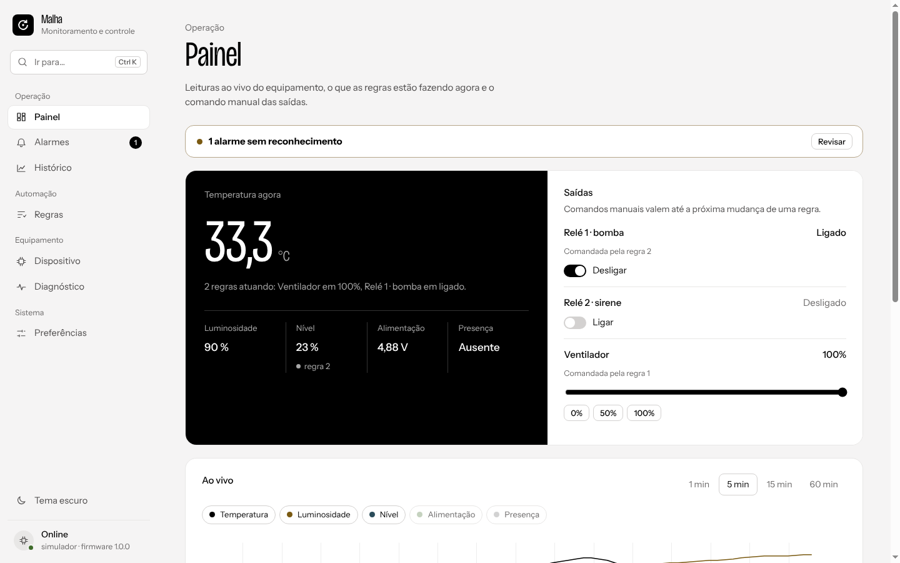
</p>

## O que a Malha faz

- **Firmware para ESP32:** lê temperatura (NTC), luminosidade (LDR), nível (analógico), tensão de alimentação (divisor) e presença (PIR), com média de 8 leituras do ADC, calibração por canal (ganho e deslocamento) e filtro de média móvel exponencial.
- **Saídas:** dois relés (bomba e sirene) e um ventilador por PWM de 25 kHz com 1.000 passos.
- **Regras no próprio dispositivo:** até 8 regras com limite, histerese, atraso e severidade. Continuam funcionando com o computador desligado.
- **Estado seguro:** se a comunicação cair, as saídas comandadas à mão desligam sozinhas (configurável). Watchdog de 5 s reinicia o ESP32 se o laço travar.
- **Memória não volátil:** configuração, calibração e regras gravadas na NVS com cabeçalho, versão e CRC. Uma gravação corrompida é ignorada e o firmware volta aos padrões.
- **Protocolo Malha Link:** quadros binários com COBS, delimitador `0x00`, número de sequência, confirmação e CRC-16/CCITT. Retransmissão automática, ping de vida a cada 2 s e reconexão sozinha quando o cabo volta.
- **Programa para Windows:** painel ao vivo, regras com editor guiado, alarmes com reconhecimento e notificação do Windows, histórico com agregação, calibração, diagnóstico do protocolo quadro a quadro, paleta de comandos e tema claro ou escuro.
- **Simulador fiel:** o núcleo do firmware (protocolo, regras, calibração, filtro, memória e estado seguro) compilado para WebAssembly roda dentro do aplicativo, ligado a uma planta virtual em que o ventilador esfria, a bomba enche o reservatório e o sensor pode falhar.
- **Wokwi:** o mesmo firmware roda no simulador de circuitos Wokwi, e o aplicativo conecta nele por TCP (RFC 2217).
- **Histórico local:** medições e eventos em SQLite (modo WAL), retenção configurável, exportação CSV pronta para o Excel em português.
- **Cópia das regras no computador:** cada regra enviada fica guardada também no banco, para restaurar depois de um reset de fábrica.

## Interface

Identidade monocromática: fundo em cinza quente, cartões brancos com cantos de 18 px, tinta preta para ações e um cartão de destaque preto que traz o número principal de cada tela. A cor aparece só para estados (verde, âmbar, vermelho e azul-acinzentado), então uma regra atuando ou um sensor sem leitura salta aos olhos sem poluir o resto. Títulos em Bricolage Grotesque condensada, texto em Instrument Sans e números técnicos em IBM Plex Mono.

- **Barra lateral** agrupada em Operação, Automação, Equipamento e Sistema, com **Ir para…** (`Ctrl K`), troca de tema e o estado da conexão sempre visível no rodapé.
- **Painel** com o cartão **Temperatura agora** (o que as regras estão fazendo e os outros quatro canais), as saídas com chave e controle deslizante, o gráfico ao vivo de 1 a 60 minutos com dois eixos, a lista de canais com minigráficos e os eventos recentes.
- **Regras** com a situação de cada uma (desligada, vigiando, atuando), editor com frase de pré-visualização ("Quando temperatura ficar acima de 30,0 °C por pelo menos 5 s, colocar Ventilador em 100%…"), exemplos prontos e restauração a partir do computador.
- **Alarmes** filtrados por severidade, reconhecimento individual ou em lote e exportação CSV.
- **Histórico** com o total de medições do período em destaque, média, mínimo e máximo de cada canal, períodos prontos ou personalizados e faixa de mínimo e máximo no gráfico.
- **Dispositivo** com conexão USB, simulador ou TCP, informações do firmware, configuração, calibração, ambiente simulado e manutenção (reiniciar e padrões de fábrica com confirmação digitada).
- **Diagnóstico** com a latência em destaque, quadros enviados e recebidos, erros de CRC e formato, retransmissões e o conteúdo hexadecimal de cada quadro.
- **Preferências** com tema, janela do gráfico, notificações, conexão automática, retenção e tamanho do banco.
- Fontes [Instrument Sans](https://github.com/Instrument/instrument-sans), [Bricolage Grotesque](https://github.com/ateliertriay/bricolage) e [IBM Plex Mono](https://github.com/IBM/plex), incluídas no aplicativo (sem CDN).

| Token | Claro | Escuro | Uso |
|---|---|---|---|
| `--bg` · `--surface` | `#F5F4F4` · `#FFFFFF` | `#0A0A0A` · `#121111` | Fundo e cartões |
| `--line` · `--line-strong` | `#E8E7E6` · `#D3D1D0` | `#333232` · `#4D4B4B` | Bordas e divisórias |
| `--text` · `--text-2` · `--text-3` | `#000000` · `#4D4B4B` · `#6B6969` | `#FFFFFF` · `#D3D1D0` · `#BAB7B6` | Texto, apoio e rótulos |
| `--ink` · `--on-ink` | `#000000` · `#FFFFFF` | `#FFFFFF` · `#000000` | Botão principal, chaves e seleção |
| `--lid` | `#000000` | `#333232` | Cartão de destaque |
| `--ok` · `--high` · `--critical` · `--info` | `#3E6B2A` · `#7A5A12` · `#9B2F1E` · `#2B4C5A` | `#9CC787` · `#E2C288` · `#E89A87` · `#99B3BF` | Normal, alta, crítica e baixa/informação |
| `--s0` … `--s4` | preto, âmbar, azul-acinzentado, verde, cinza | versões claras | Séries dos gráficos |

| Atalho | Ação |
|---|---|
| `Ctrl K` | Ir para… (paleta de comandos) |
| `Ctrl 1` … `Ctrl 7` | Painel, Alarmes, Histórico, Regras, Dispositivo, Diagnóstico, Preferências |
| `Esc` | Fechar diálogo ou paleta |

| Tela | |
|---|---|
| 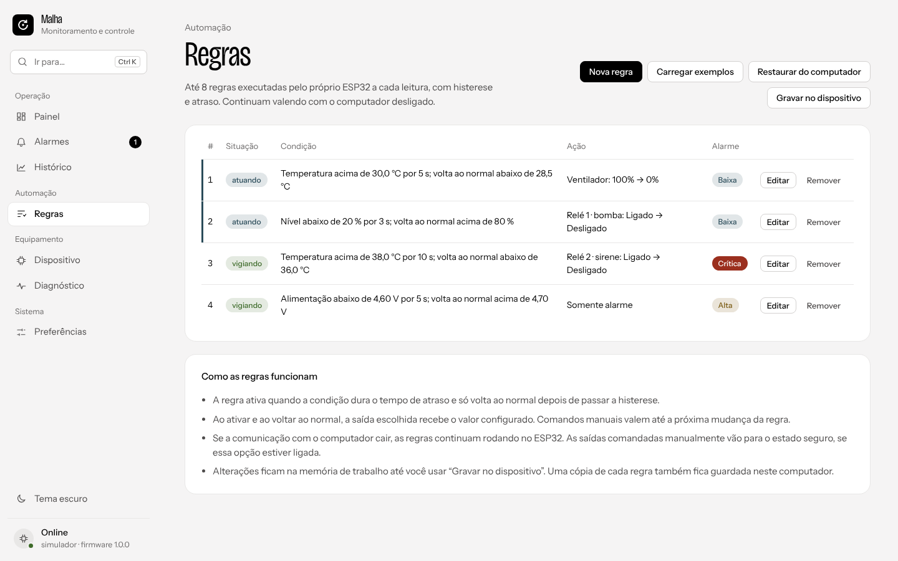 | 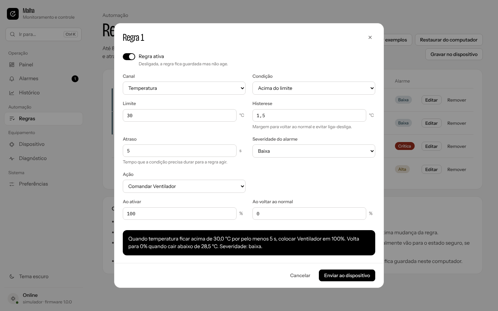 |
| 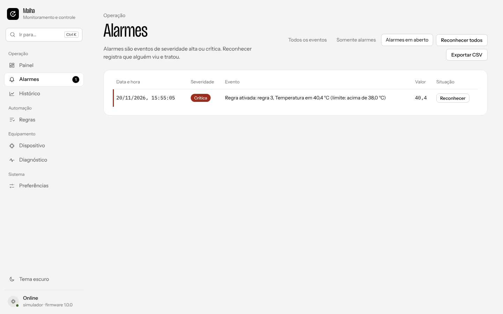 | 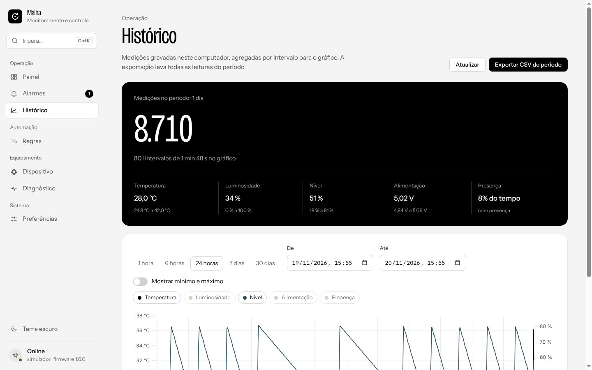 |
| 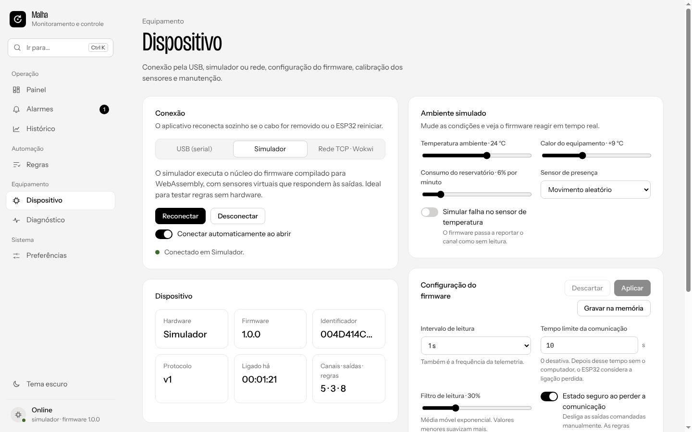 | 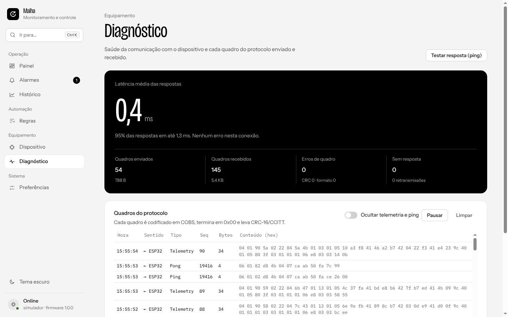 |
| 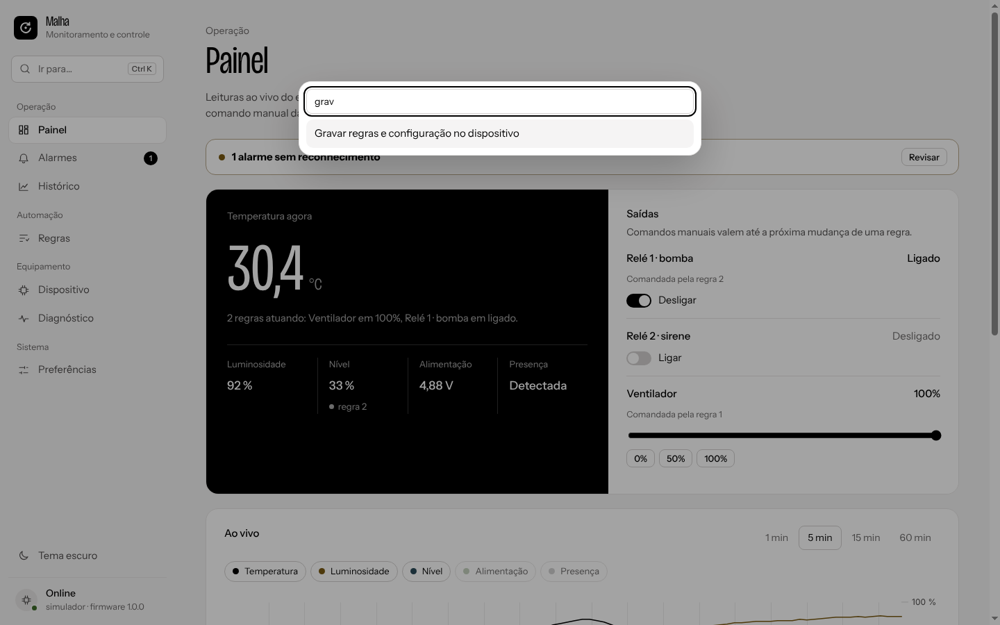 | 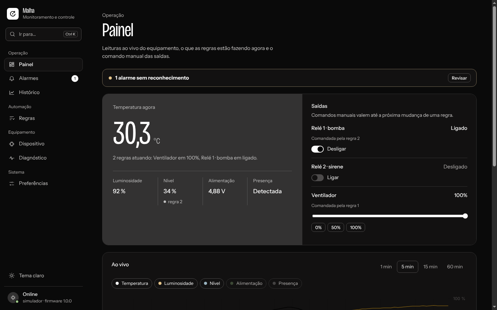 |
| 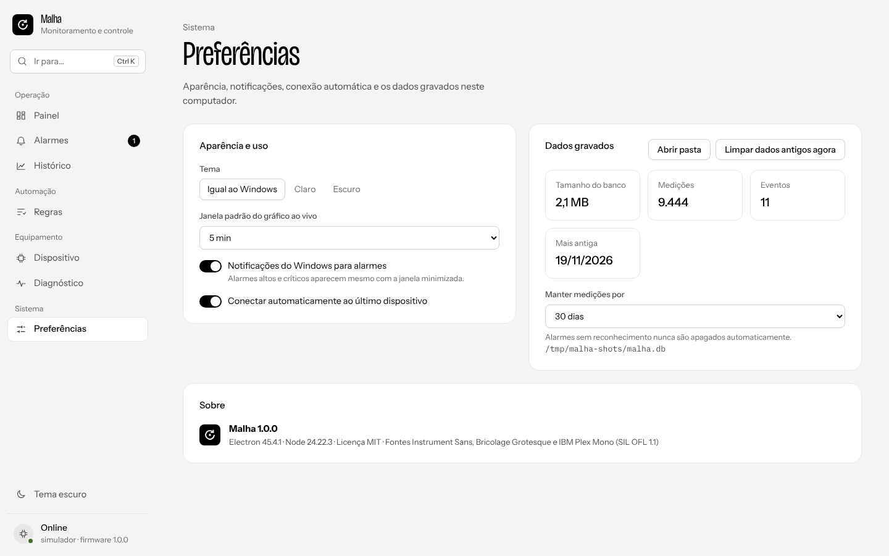 | 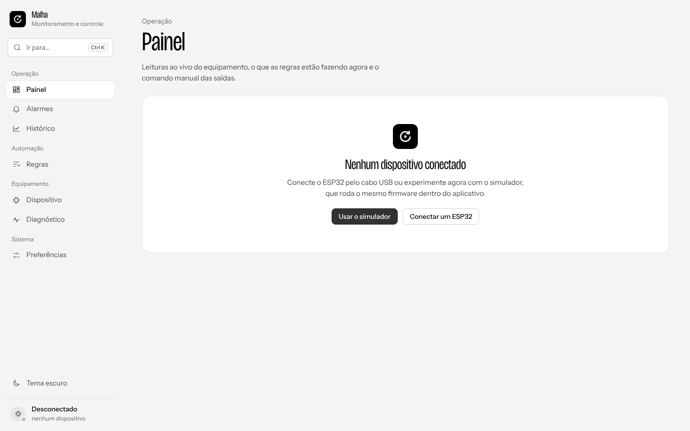 |

## Arquitetura

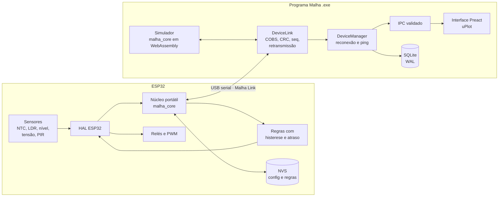

O núcleo `malha_core` não conhece o Arduino: tudo que toca o hardware passa pela interface `Hal`. Por isso o mesmo código é testado no PC (Unity), roda no ESP32 e roda no aplicativo como WebAssembly, com uma `Hal` diferente em cada lugar.

## Protocolo Malha Link

| Campo | Bytes | Conteúdo |
|---|---|---|
| Versão | 1 | `1` |
| Tipo | 1 | Comando, resposta ou mensagem espontânea |
| Sequência | 2 | Little-endian. Respostas repetem a sequência do pedido |
| Tamanho | 2 | Tamanho do corpo, até 240 |
| Corpo | 0 a 240 | Campos little-endian, `float` IEEE 754 |
| CRC | 2 | CRC-16/CCITT-FALSE de versão a corpo |

O quadro inteiro é codificado em COBS e termina em `0x00`, então qualquer byte perdido só derruba aquele quadro e o próximo `0x00` ressincroniza a leitura.

| Pedido (PC → ESP32) | Resposta | Função |
|---|---|---|
| `Hello 0x01` | `Info 0x81` | Versão do protocolo e do firmware, identificador, canais, saídas, regras, tempo ligado |
| `Ping 0x02` | `Pong 0x82` | Ecoa 4 bytes; mantém a ligação viva |
| `GetConfig 0x03` · `SetConfig 0x11` | `Config 0x83` · `Ack 0x80` | Intervalo de leitura, tempo limite, estado seguro, filtro e calibração |
| `GetRules 0x04` · `SetRule 0x13` · `ClearRule 0x14` | `Rules 0x84` · `Ack` | Lista, grava e apaga regras |
| `SetOutput 0x10` | `Ack` | Relé `0/1`, PWM `0…1000` |
| `SetCalibration 0x12` | `Ack` | Ganho e deslocamento de um canal |
| `Save 0x15` · `Reboot 0x16` · `FactoryReset 0x17` | `Ack` | Grava na NVS, reinicia, apaga tudo |
| — | `Telemetry 0x90` | A cada leitura: valores, saídas e regras ativas |
| — | `Event 0x91` | Partida, regra ativada ou desativada, ligação perdida, falha de sensor |

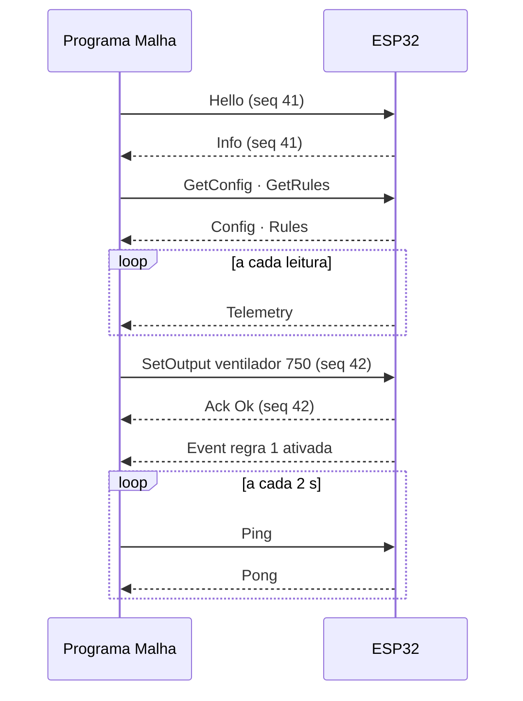

Os vetores oficiais em [`protocol/vectors.json`](protocol/vectors.json) são gerados por uma terceira implementação independente, em Python ([`protocol/gerar_vetores.py`](protocol/gerar_vetores.py)), e os testes do firmware e do aplicativo conferem os mesmos bytes.

## Regras de automação

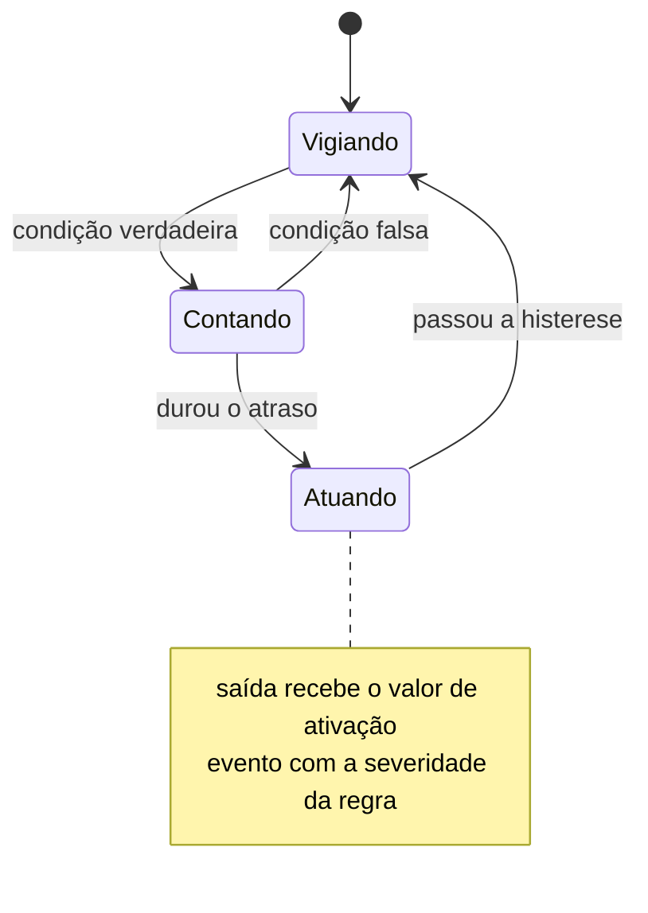

- A condição é `acima` ou `abaixo` de um limite. A regra só volta ao normal depois de passar a histerese (por exemplo, liga acima de 30 °C e desliga abaixo de 28,5 °C).
- Ao ativar e ao voltar, a saída escolhida recebe o valor configurado. Um comando manual vale até a próxima mudança da regra.
- Regras sem saída servem só de alarme. Severidades: informação, baixa, alta e crítica. Alta e crítica viram alarmes no programa.
- Exemplos prontos: ventilador por temperatura, bomba por nível (liga abaixo de 20%, desliga acima de 80%), sirene crítica acima de 38 °C e alarme de alimentação abaixo de 4,6 V.

## Hardware

| Função | GPIO | Peça sugerida |
|---|---|---|
| Temperatura | 34 | Módulo NTC 10 kΩ (β 3950) |
| Luminosidade | 35 | Módulo LDR com saída analógica |
| Nível | 32 | Sensor de nível analógico ou potenciômetro |
| Alimentação | 33 | Divisor 100 kΩ / 100 kΩ |
| Presença | 27 | PIR HC-SR501 |
| Relé 1 (bomba) | 26 | Módulo relé 5 V com optoacoplador |
| Relé 2 (sirene) | 25 | Módulo relé 5 V com optoacoplador |
| Ventilador (PWM 25 kHz) | 14 | MOSFET logic-level (IRLZ44N) e diodo de roda livre |
| LED de estado | 2 | LED da própria placa |

O LED pisca rápido sem comunicação e lento com o programa conectado. O circuito completo está em [`firmware/diagram.json`](firmware/diagram.json), pronto para o [Wokwi](https://wokwi.com).

## Como rodar

### Só o programa (sem hardware)

1. Baixe `Malha-1.0.0-portatil.exe` (não precisa instalar) ou `Malha-Setup-1.0.0.exe` na aba **Releases**.
2. Abra e clique em **Usar o simulador**.
3. Em **Regras**, clique em **Carregar exemplos**. Em **Dispositivo › Ambiente simulado**, aumente o calor e veja o ventilador e a sirene atuarem.

### Com o ESP32

Pré-requisitos: [PlatformIO](https://platformio.org) (extensão do VS Code ou `pip install platformio`) e o driver USB da placa (CP210x ou CH340).

```bash
git clone https://github.com/ravelroot/Embedded-Monitoring-and-Control-System.git
cd Embedded-Monitoring-and-Control-System/firmware
pio run -e esp32dev -t upload
```

Feche o monitor serial da IDE, abra o programa, vá em **Dispositivo**, escolha a porta (a do ESP32 aparece primeiro, marcada como provável ESP32) e clique em **Conectar**.

### No Wokwi

Com a extensão Wokwi do VS Code, compile (`pio run -e esp32dev`), abra `firmware/diagram.json` e inicie a simulação. No programa, conecte por **Rede TCP · Wokwi** em `localhost:4000` com RFC 2217 ligado.

### Pelo código-fonte

Pré-requisito: **Node.js 22** ou mais recente.

**Windows:** dê dois cliques em `iniciar.cmd`. Na primeira vez ele instala as dependências.

```bash
cd desktop
npm ci
npm start
```

### Gerar o .exe

**Windows:** dê dois cliques em `gerar-exe.cmd`. O script instala as dependências, roda a verificação de tipos e os testes e coloca `Malha-Setup-1.0.0.exe` e `Malha-1.0.0-portatil.exe` na raiz do projeto.

```bash
cd desktop
npm run dist
```

Ao publicar uma tag `v*`, o workflow [`release.yml`](.github/workflows/release.yml) gera os dois executáveis no Windows e os anexa à release.

## Banco de dados

O programa grava em `%APPDATA%\Malha\malha.db` (SQLite em modo WAL, com chaves estrangeiras e verificações ligadas).

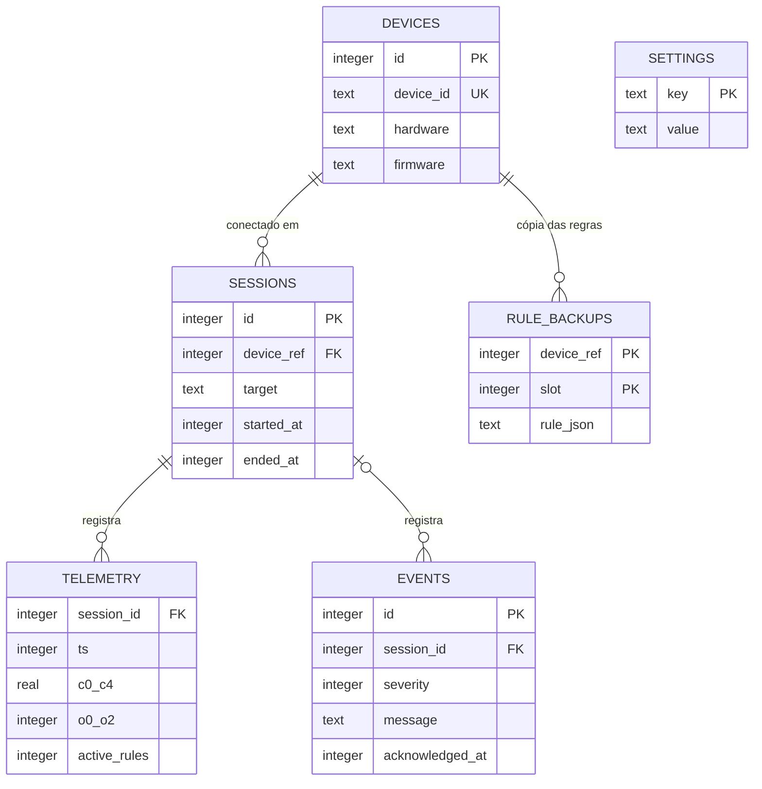

| Tabela | O que guarda |
|---|---|
| `devices` | Cada ESP32 (ou o simulador) pelo identificador de fábrica, hardware, firmware, primeira e última conexão |
| `sessions` | Cada conexão: dispositivo, porta, início, fim e motivo do fim |
| `telemetry` | Uma linha por leitura: data, tempo ligado, sinais, cinco canais, três saídas e regras ativas |
| `events` | Eventos e alarmes com severidade, valor, mensagem e momento do reconhecimento |
| `rule_backups` | Cópia em JSON de cada regra enviada, por dispositivo e posição |
| `settings` | Preferências do programa em JSON |
| `schema_version` | Migrações aplicadas |

No ESP32, a configuração e as 8 regras ficam num bloco de 205 bytes na NVS (`malha/settings`): assinatura `MLH1`, versão, configuração, regras e CRC-16. O diagrama completo, o dicionário de dados e o formato do bloco estão em [`Banco-de-Dados-Malha.pdf`](Banco-de-Dados-Malha.pdf).

## Estrutura

```
firmware/
  lib/malha_core/   núcleo portátil: protocolo, COBS, CRC, regras, sensores, configuração, controlador
  src/              HAL do ESP32 (ADC, GPIO, PWM, NVS, watchdog) e laço principal
  wasm/             ponte do núcleo para WebAssembly (simulador do programa)
  test/             testes Unity: protocolo, regras, controlador e vetores
  diagram.json      circuito para o Wokwi
protocol/           vetores oficiais do protocolo e o gerador independente em Python
desktop/
  src/main/         processo principal: transportes (USB, TCP, simulador), link, gerenciador, SQLite, exportação, IPC
  src/preload/      ponte segura entre a interface e o processo principal
  src/renderer/     interface em Preact, gráficos uPlot, telas e estilos
  src/shared/       modelo de dados, contrato da API e validação
  test/             testes node:test
  assets/           ícones e o núcleo do firmware em WebAssembly
scripts/            inicialização e geração do .exe no Windows
docs/               imagens, manual e diagrama do banco
```

## Testes

```bash
cd firmware && pio test -e native
cd desktop && npm test
```

São 61 casos: 31 no firmware (com AddressSanitizer e UBSan na verificação local) e 30 no programa. Eles provam, entre outras coisas, que o CRC bate com o valor de verificação da norma, que o COBS ressincroniza depois de lixo na linha, que firmware, programa e o gerador em Python produzem exatamente os mesmos bytes, que a regra só atua depois do atraso e só volta depois da histerese, que a perda de comunicação leva as saídas manuais ao estado seguro, que a configuração sobrevive a uma reinicialização e que uma gravação corrompida é recusada, que o simulador em WebAssembly executa regras, grava, reinicia e detecta falha de sensor, que o histórico agrega por intervalo, que dados antigos são apagados sem perder alarmes em aberto, que a validação recusa entradas fora do padrão e que o CSV neutraliza fórmulas.

A integração contínua ([`.github/workflows/ci.yml`](.github/workflows/ci.yml)) confere os vetores, roda os testes nativos, compila o firmware para o ESP32 e o núcleo para WebAssembly, e no Windows roda a verificação de tipos, os testes, a auditoria das dependências e gera os executáveis.

## Segurança e privacidade

- O repositório não traz senhas, chaves, endereços nem dados pessoais. O banco fica só na pasta do usuário no Windows.
- A interface roda isolada: `contextIsolation`, `sandbox`, sem `nodeIntegration`, navegação e novas janelas bloqueadas e permissões negadas, exceto notificações.
- Política de segurança de conteúdo sem scripts externos nem inline (`default-src 'none'`), fontes e estilos só do próprio aplicativo.
- Cada chamada da interface passa por uma lista fechada de canais e é validada no processo principal (tipos, faixas, portas `COMn`, endereços TCP), e só a janela principal é aceita como origem.
- O firmware valida tamanho e faixa de todo comando e responde com um código de erro, sem aplicar nada parcialmente. Quadros com CRC errado são descartados.
- Consultas SQL sempre parametrizadas. O CSV coloca um apóstrofo antes de células que começam com `=`, `+`, `-` ou `@`.
- Restaurar os padrões de fábrica exige digitar `RESTAURAR`.
- Nada é enviado para a internet: sem telemetria, sem atualizações automáticas, sem CDN.

## Licença

[MIT](LICENSE). As fontes Instrument Sans, Bricolage Grotesque e IBM Plex Mono são distribuídas sob a SIL Open Font License 1.1.
